<!-- ─────────────── 🌷 header ─────────────── -->

  

<!-- ─────────────── ✧ introduction ─────────────── -->

  

  <i>✿ curious mind · creative soul · aspiring Software Engineer ✿</i>

<!-- ─────────────── ୨୧ about me ─────────────── -->

<h3 align="center">୨୧ a little about me ୨୧</h3>

  I started building (sometimes unfinished 😭) projects out of curiosity, 
  exploring different technologies and discovering what I enjoy along the way.

  I'm particularly interested in <b>backend engineering</b>, <b>REST APIs</b>, <b>fintech</b>, and building meaningful things — 
  including a little Harry Styles retro game I made as a memory of attending his concert 🥹

<!-- ─────────────── ୨୧ tech stack ─────────────── -->

<h3 align="center">୨୧ favourite tools &amp; concepts ୨୧</h3>

  &nbsp;&nbsp;
  &nbsp;&nbsp;
  &nbsp;&nbsp;
  

  
  
  

<!-- ─────────────── ୨୧ projects ─────────────── -->

<h3 align="center">୨୧ things i've built so far ୨୧</h3>

  a little collection of projects I've worked on, experimented with, and had fun building ♡

<table>
  <tr>
    <td width="50%" valign="top">
      <h4>📈 <a href="https://github.com/Ouissem-S/Investment-Portfolio" title="open Investment Portfolio API ♡">Investment Portfolio API</a></h4>
      
A REST API built with Python and FastAPI for managing investment holdings, including stocks, ETFs and crypto. Designed with a clean, layered architecture.

      
<code>python</code> <code>fastapi</code> <code>rest api</code>

    </td>
    <td width="50%" valign="top">
      <h4>🎸 <a href="https://github.com/Ouissem-S/Harry-Styles-Wembley-Retro-2000s-game" title="open Harry Styles: Dance All the Time ♡">Harry Styles: Dance All the Time</a></h4>
      
A retro 2000s-inspired rhythm game based on my experience of seeing Harry Styles perform at Wembley. Pixel art, music and a little nostalgia.

      
<code>rhythm game</code> <code>pixel art</code> <code>music</code>

    </td>
  </tr>
  <tr>
    <td width="50%" valign="top">
      <h4>📖 <a href="https://github.com/Ouissem-S/Facile" title="open Facile ♡">Facile</a></h4>
      
Take a picture of a book page and read it in simpler English or French.

      
<code>reading</code> <code>english</code> <code>français</code>

    </td>
    <td width="50%" valign="top">
      <h4>🎵 <a href="https://github.com/Ouissem-S/Guess-the-Music" title="open Guess the Music ♡">Guess the Music</a></h4>
      
An AI-powered music guessing game built with Python and an LLM API, exploring prompts, structured outputs and AI evaluation.

      
<code>python</code> <code>llm api</code> <code>ai evaluation</code>

    </td>
  </tr>
  <tr>
    <td width="50%" valign="top">
      <h4>🎤 <a href="https://github.com/Ouissem-S/EUPHORIE" title="open EUPHORIE ♡">EUPHORIE</a></h4>
      
A live concert brought home — turning phones into synchronised wristband lights to recreate the feeling of being in a crowd.

      
<code>live music</code> <code>synchronised lights</code>

    </td>
    <td width="50%" valign="top">
      <h4>🌻 <a href="https://github.com/Ouissem-S/Sunflower" title="open SUNFLOWER ♡">SUNFLOWER</a></h4>
      
A webcam hand-tracking app that recreates the SpongeBob "Imagination" rainbow meme using OpenCV and MediaPipe Hands.

      
<code>opencv</code> <code>mediapipe hands</code> <code>webcam</code>

    </td>
  </tr>
</table>

<!-- ─────────────── ୨୧ beyond coding ─────────────── -->

<h3 align="center">୨୧ outside of CS ୨୧</h3>

  you'll probably find me…  
  📚 reading &nbsp;&nbsp;♡&nbsp;&nbsp; 🎹 creating music &nbsp;&nbsp;♡&nbsp;&nbsp; 🎮 playing video games

<!-- ─────────────── 🎀 footer ─────────────── -->

 

   
  <i>thanks for stopping by! ♡</i>

  

